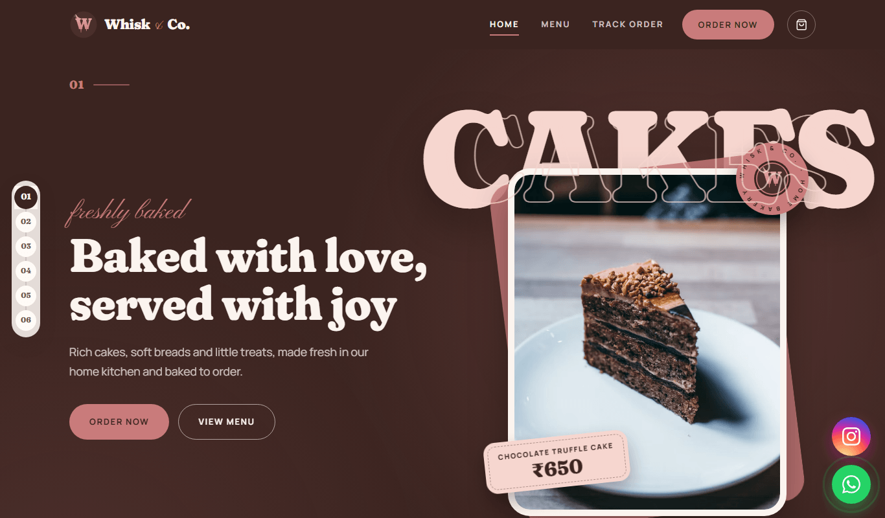
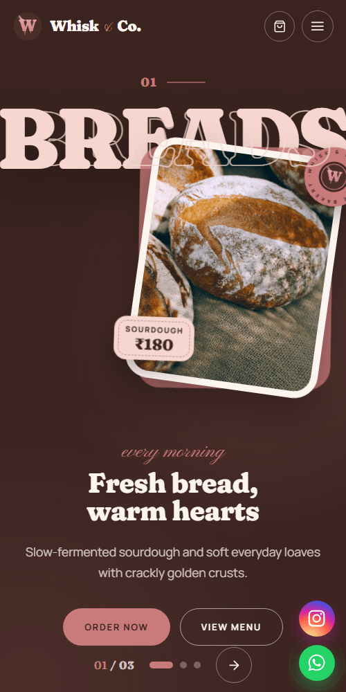
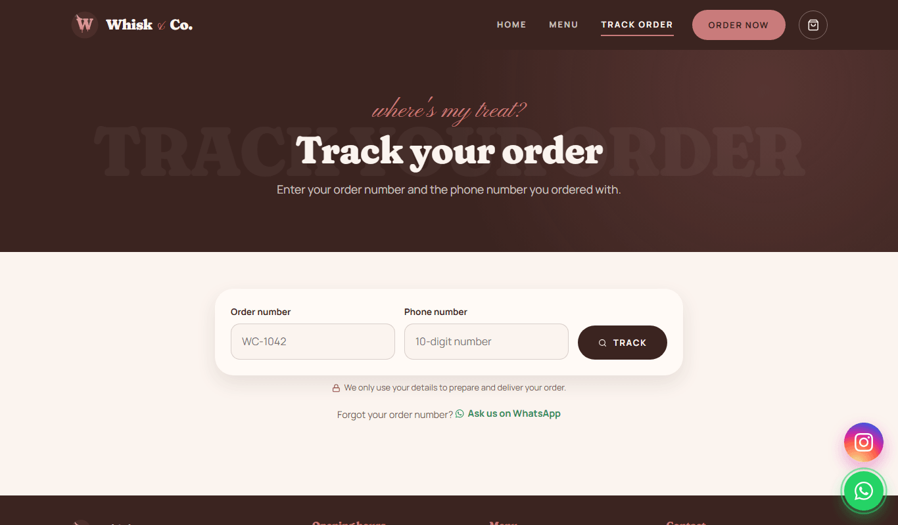

<p align="center">
  
</p>

<h1 align="center">Whisk &amp; Co.</h1>

<p align="center">
  A full-stack ordering website for a real home bakery: menu, cart, checkout, order tracking,
  and a simple admin panel the (non-technical) owner uses to manage orders and the menu.
</p>

<p align="center">
  <a href="https://whisk-and-co.vercel.app"><strong>Live site</strong></a> ·
  <a href="https://whisk-and-co-api.onrender.com">API</a>
</p>

<p align="center">
  
</p>

> The API runs on Render's free plan, which sleeps after 15 minutes without visitors.
> The first visit can take up to a minute while it wakes up (the site shows "Waking up the oven…").

## Features

**For customers**
- Menu with categories, search, sold-out items and festive special offers (with offer prices and dates)
- Shopping cart saved in the browser, with a note per item (e.g. the message on a cake)
- Checkout for pickup or delivery, with the bakery's real date rules (no same-day orders on Sundays, Sunday orders only until Saturday 8 PM, in India time)
- Order numbers like `WC-1042` and a **Track order** page that shows the order's progress
- Order on WhatsApp with a ready-made message
- Light and dark mode, works on phones, respects "reduce motion"

**For the bakery owner (admin)**
- Secure login, and "Change password" so the handover password can be replaced
- Orders page with search (order number, name or phone), status filters and a one-way status flow (new → baking → ready → delivered, or cancelled)
- Manage menu: add, edit, mark sold out, archive or delete items, upload photos, run special offers
- An email for every new order

<p align="center">
  
  &nbsp;&nbsp;
  
</p>

## Tech stack

| Part | Tools |
|---|---|
| Frontend | React 19, React Router 7, Vite, Motion (animations), plain CSS with design tokens |
| Backend | Node.js, Express 5, Mongoose, JSON Web Tokens, bcrypt, express-rate-limit, Multer |
| Database | MongoDB Atlas |
| Services | Cloudinary (menu photos), Resend (order emails) |
| Hosting | Vercel (website), Render (API) |
| Quality | 50 backend tests (node:test, Supertest, an in-memory MongoDB), oxlint |

## Things I paid attention to

- **The server decides the price.** The browser only sends which items and how many; the server looks up names and prices in the database (including active offers) and works out the total, so prices can't be changed in the browser.
- **Order status only moves forward.** The same rules live on the server and in the admin page. Finished orders are locked, and a status change only saves if nobody else changed the order meanwhile.
- **Customer privacy.** Tracking an order needs both the order number and the phone number, sent in the request body (not the URL), and the answer leaves out the name, phone and address. A wrong number and a wrong phone give the same message.
- **Security basics.** Rate limits on login, ordering and tracking; passwords stored as bcrypt hashes; protection against NoSQL injection; CORS limited to the website's address; all secrets in environment variables only.
- **Time zones.** The server runs in UTC but the bakery is in India, so every "today" check uses Asia/Kolkata.
- **Made for the real owner.** Everything in the admin panel is in plain English, actions that can't be undone ask first, and the site still saves an order even if the email fails.

## Project structure

```
client/                 React website (Vercel)
  src/pages/            Home, Menu, Product, Checkout, Track, 404 and the admin pages
  src/components/       Navbar, cart, logo, Home chapters and other building blocks
  src/hooks/            Shared data: menu, cart, theme, admin session
  scripts/              Makes the logo files, favicons and link-preview image
server/                 Express API (Render)
  routes/               orders, products, auth
  models/               Order, Product, Admin, Counter (order numbers)
  utils/                India time rules, order status rules, order email
  tests/                Backend tests
```

## Run it on your computer

You need [Node.js](https://nodejs.org) 22 or newer and a free [MongoDB Atlas](https://www.mongodb.com/atlas) database.

```bash
git clone https://github.com/SamikshaShinde1/-Whisk_And_Co.git
cd -- -Whisk_And_Co
```

**1. The API**

```bash
cd server
npm install
cp .env.example .env      # then fill in MONGO_URI, JWT_SECRET, ADMIN_EMAIL and ADMIN_PASSWORD
npm run create-admin      # creates the admin login from .env
npm run seed-products     # copies the starting menu into the database
npm run dev               # http://localhost:5000
```

Cloudinary (photo uploads) and Resend (order emails) are optional: without their keys the rest still works.

**2. The website** (in a second terminal)

```bash
cd client
npm install
cp .env.example .env      # VITE_API_URL=http://localhost:5000, plus your WhatsApp number
npm run dev               # http://localhost:5173
```

The admin panel is at `/admin/login` (or "Staff login" in the footer).

## Tests

```bash
cd server
npm test
```

The tests start their own in-memory MongoDB, so they don't touch the real database. They cover ordering and pricing, special offers, the Sunday date rules, order status changes, tracking and the order email.

## Credits

- Menu photos: [Unsplash](https://unsplash.com) (placeholders until the bakery's own photos are uploaded)
- Fonts: Fraunces, Pinyon Script and Manrope from Google Fonts
- Built with the help of [Claude Code](https://claude.com/claude-code) as an AI pair programmer; `CLAUDE.md` holds the project notes it works from.
